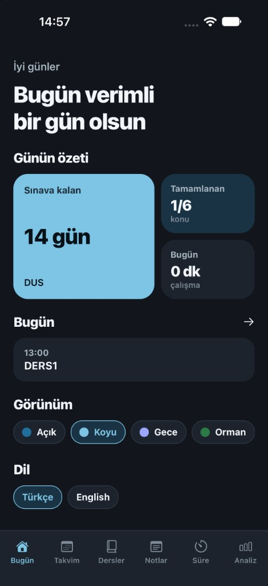
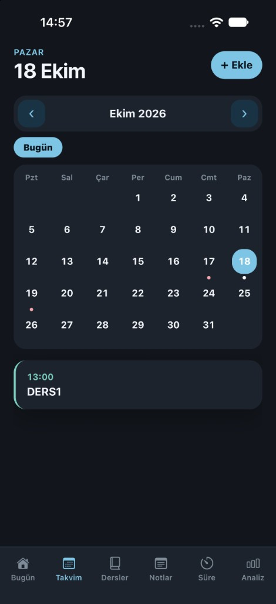
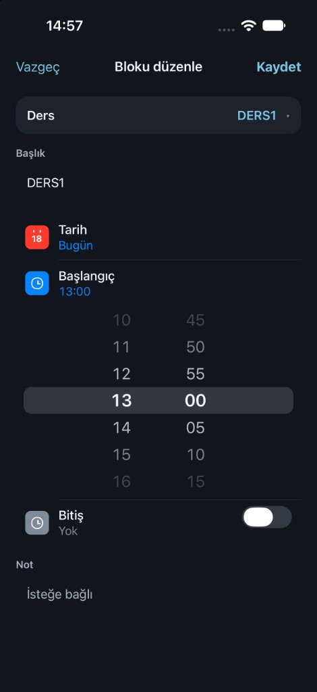
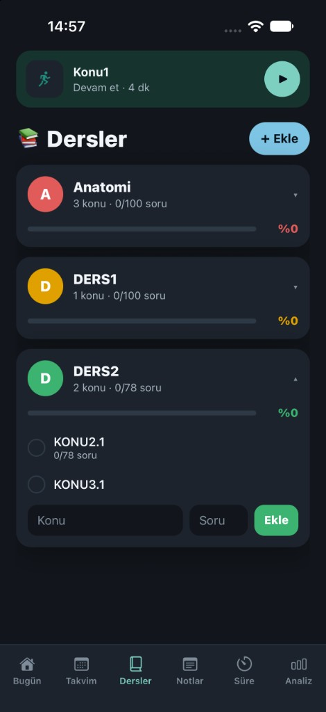
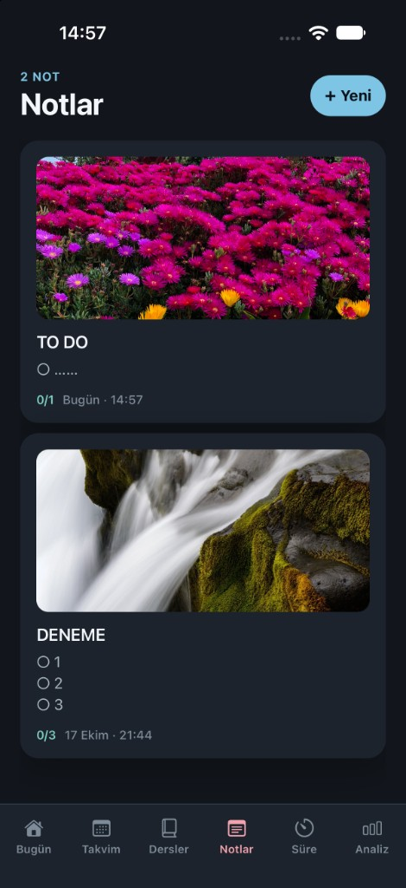
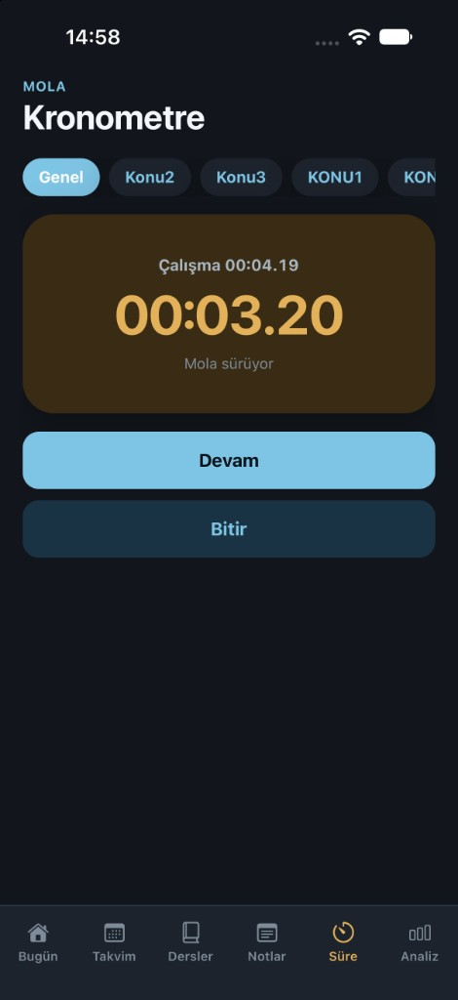
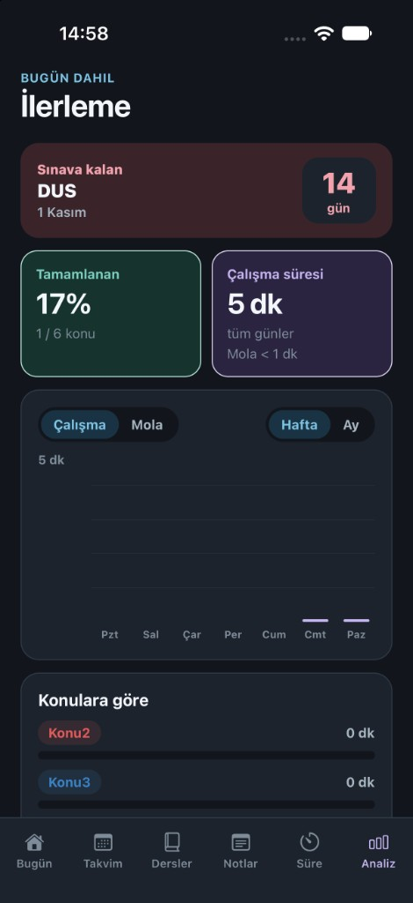

# Ajanda

Kişisel çalışma takvimi. Ders programı, konular, kronometre, notlar ve sınav geri sayımı telefonda durur. Sunucu yok; veriler `expo-sqlite` ile cihazda saklanır.

Varsayılan dil Türkçe. Bugün ekranından İngilizceye geçilebilir. Tema seçimi de orada durur: Açık, Koyu, Gece, Orman, Orman koyu, Okyanus, Okyanus koyu, Mavi.

## Ekranlar

**Bugün.** Günün özeti: sınava kalan gün, biten konu sayısı, bugünkü çalışma süresi ve o günün dersleri.



**Takvim.** Ay görünümünden güne geçilir. Bir güne ders bloğu eklenir. Ders, kayıtlı derslerden seçilir; saat ve isteğe bağlı not yazılır.





**Dersler.** Dersin konuları ve soru sayısı tutulur. Bir konudan kronometre başlatılır.



**Notlar.** Fotoğrafın altına not yazılır. Metin boyutu, madde, numaralı liste ve yapılacak listesi seçilir.



**Süre.** Çalışma ve mola ayrı sayılır. Süre hem genel toplama hem seçilen konuya yazılır.



**Analiz.** Sınava kalan gün, tamamlanan konu oranı, çalışma ve mola grafikleri. Grafik hafta ya da ay olarak bakılır.



## Kurulum

Node.js gerekir.

```bash
npm install
npm start
```

`npm start` geliştirme sunucusunu açar. Ardından:


- Android emülatörü için `a`
- iPhone simülatörü için `i`
- tarayıcı için `w`

Aynı iş ayrı komutlarla da yapılır:

```bash
npm run android
npm run ios
npm run web
```

`npm run android` ve `npm run ios` uygulamayı derleyip takılı emülatöre kurar. Bu sürüm bilgisayardaki sunucuya bağlıdır. Telefona gönderilecek dosya değildir.

## Android APK

Arkadaşının Android telefonuna kurulacak dosya release APK’dır. İçinde uygulama kodu vardır; bilgisayarın açık kalması gerekmez.

İlk derlemede JDK 21 ve Android SDK kurulu olmalıdır. Gradle, Java 27 ile derlemez.

```bash
npm install
npx expo prebuild --platform android
cd android
./gradlew assembleRelease
```

APK burada oluşur:

```text
android/app/build/outputs/apk/release/app-release.apk
```

Dosya yaklaşık 95 MB olduğu için mail çoğu zaman takılır. Telefona kabloyla kopyalanır ya da bir dosya linkiyle gönderilir.

Telefonda APK açılır, **Yükle**’ye basılır. Telefon “bu kaynaktan yüklemeye izin yok” derse ayardan o kaynağa izin verilir, sonra yükleme tekrarlanır.

## iPhone

iPhone APK kurmaz. Simülatörde denemek için:

```bash
npm run ios
```

Gerçek iPhone’a kurmak için telefonun bu Mac’e kabloyla takılması gerekir. Ücretsiz Apple hesabıyla kurulum yaklaşık 7 gün durur. App Store ya da TestFlight için yıllık Apple Geliştirici Programı üyeliği gerekir.
